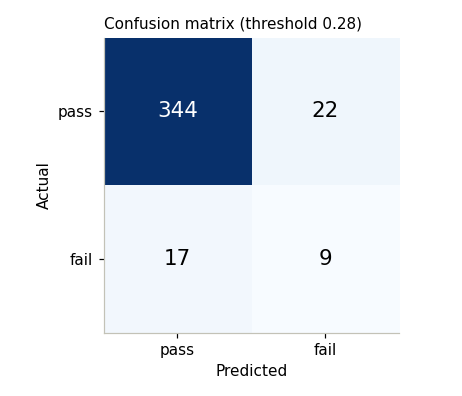
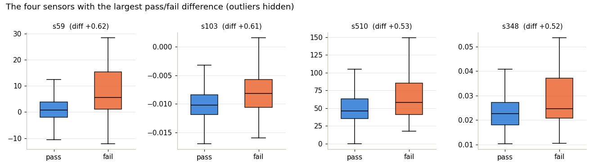
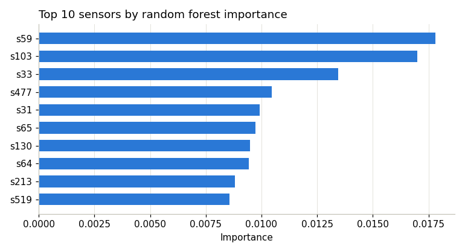

# SECOM semiconductor yield analysis (Python)

Finding which sensor readings warn of failing production runs in semiconductor manufacturing, using the UCI SECOM dataset and a random forest classifier.

## The problem

A semiconductor production line records hundreds of sensor measurements for every run. Some runs fail the final quality test. If a model can flag likely failures from the sensor data, engineers can inspect or adjust earlier and know which process signals to watch.

The SECOM dataset has 1,567 production runs from July to October 2008, each with 590 anonymised sensor readings and a pass/fail label. Only 104 runs (6.6%) failed.

## Approach

1. **Load and inspect.** 4.5% of all readings are missing. 28 sensors are more than half empty and 116 never change value.
2. **Clean.** Dropped those 144 sensors, leaving 446. Filled remaining gaps with each sensor's median, calculated from the training data only so no information leaks from the test set.
3. **Explore.** Compared each sensor's average in failing and passing runs, scaled by its standard deviation. The biggest gaps are about 0.6 standard deviations (sensors s59 and s103), and pass and fail ranges overlap heavily, so no single sensor separates them.
4. **Model.** Random forest (500 trees, `class_weight="balanced"`) on a stratified 75/25 train/test split. Chose the decision threshold with 5-fold cross-validation on the training set, then tested once.
5. **Interpret.** Ranked sensors by the model's feature importance.

## Results

**Accuracy is the wrong measure here.** A model that predicts "pass" for every run scores 93.4% accuracy and catches no failures. The random forest at its default 0.5 threshold did exactly the same: 93.4% accuracy, 0 of 26 test failures caught. Its ROC AUC of 0.815 showed it was ranking failing runs higher, just rarely above 0.5.

With a threshold of 0.28 chosen by cross-validation, on the 392-run test set:

| | Predicted pass | Predicted fail |
|---|---|---|
| **Actual pass** | 344 | 22 |
| **Actual fail** | 17 | 9 |

- Recall on failures: **35%** (9 of 26 caught)
- Precision on failures: **29%** (9 of 31 flagged runs were real failures)
- Accuracy: 90.1%

Lowering the threshold to 0.20 would catch 19 of 26 failures (73%) but raise 95 false alarms. The right setting depends on what a missed failure costs compared with an extra inspection.



**Sensors to watch.** s59 and s103 have the largest pass/fail difference and are also the two sensors the model relies on most. The rest of the top 10 are s33, s477, s31, s65, s130, s64, s213 and s519. Importance is spread thinly (the top 10 carry 11.5% of the total), which points to many small effects rather than one faulty step. A process engineer would start by finding which steps s59 and s103 measure and whether they drift before failures.




## Limitations

- Sensor names are hidden, so results can't be tied to physical process steps.
- Only 26 failures in the test set, so each one moves recall by about 4 percentage points.
- The split is random, not by time. A real deployment would train on past runs and predict future ones, where process drift matters.
- Random forest importance can split credit between correlated sensors.

With more time I would test a time-based split, remove highly correlated sensors, compare with logistic regression, and check the top sensors with permutation importance.

## Tools

Python, pandas, NumPy, scikit-learn (random forest, stratified split, cross-validation, metrics), matplotlib, Jupyter in VS Code.

## How to run it

1. Download the dataset from the [UCI repository](https://archive.ics.uci.edu/dataset/179/secom) and put `secom.data` and `secom_labels.data` in a folder called `data/` inside this repo.
2. Install the packages:
   ```
   pip install -r requirements.txt
   ```
3. Open `secom_analysis.ipynb` and run all cells.

The `data/` folder is in `.gitignore`, so the raw data is not stored in this repo.
